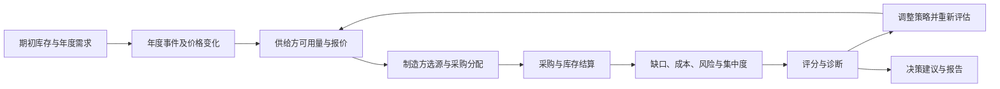

# 铀供应链事中场景与页面梳理

更新日期：2026-09-26。范围：铀供应链事中入口、建模、想定、实体关系、实验管理、年度态势、案例、决策分析与报告。

本文是本轮页面优化的业务依据和验收清单。先确认场景含义，再调整信息结构、文案与交互。这里记录实现边界；产品界面只呈现用户需要理解的业务信息。

## 1. 依据与优先级

同一概念有多种说法时，以当前后端场景实现为准，其次参考后端文档，最后检查前端已有展示。通用 Agent 配置不能直接代替铀场景 `during` 的实际逻辑。

| 依据 | 需要核对的内容 |
| --- | --- |
| [后端场景说明](/root/sgm-cmse/docs/uranium_supply_chain_process.md) | 场景边界、年度流程、角色、结果结构 |
| [年度与预设常量](/root/sgm-cmse/src/scene/uranium_supply_chain/during/defaults.py) | 历史、训练、验证和前瞻年份 |
| [实验工作流](/root/sgm-cmse/src/scene/uranium_supply_chain/during/workflow.py) | 六种预设、覆盖参数、报告构造 |
| [实体装载](/root/sgm-cmse/src/scene/uranium_supply_chain/during/data.py) | 制造方含义、初始化字段、事件分类与持续期 |
| [采购策略](/root/sgm-cmse/src/scene/uranium_supply_chain/during/policies.py) | 决策权重、目标库存、供应方数量、采购限制 |
| [评分实现](/root/sgm-cmse/src/scene/uranium_supply_chain/during/scoring.py) | 指标聚合、六维评分、目标值方向 |
| [诊断实现](/root/sgm-cmse/src/scene/uranium_supply_chain/during/diagnostics.py) | 缺口、库存、集中度、风险与成本信号 |
| [闭环定义](/root/sgm-cmse/src/scene/uranium_supply_chain/during/closed_loop.py) | 执行、评分、诊断、优化、报告的关系 |
| [接口服务](/root/sgm-cmse/tofront/service/uranium_during_service.py) | 参数定义与 API 返回结构 |
| [事件目录](/root/sgm-cmse/data/processed_uranium/structured/events.json) | 历史事件、未来情景、年份和影响范围 |
| [对比实验说明](/root/sgm-cmse/docs/experiments.md) | 策略 × 冲击矩阵、训练与验证的区别 |
| [现有前端联动说明](./uranium-during-frontend.md) | 会话、草稿、实验、分析页的数据流与当前接入边界 |

参考界面：`../MACE-FE2/frontend/src/views/crowdSim/workbench/CrowdSimGlobalShell.vue` 的统一上下文、时间轴和事件入口；`../MACE-FE2/frontend/src/views/powerGame/ExpAnalysis_DecisionTree.vue` 的配置与结果分区、树节点详情。采用其信息组织方式，不照搬视觉装饰、业务术语或时间尺度。

## 2. 场景基础知识

### 2.1 研究问题与边界

铀场景研究中国核电采购主体在供给、价格、政策、出口和运输冲击下，如何选择供应来源、配置采购量与库存，并维持年度需求保障。

主要决策是采购组合、长协与现货偏好、供应来源分散、库存目标和预算约束。当前后端没有核电机组运行、燃料组件生产排程、转化/浓缩工艺或真实合同结算模型。页面不能据此承诺“几小时扩产”“24 小时恢复机组运行”或精确到天的采购策略效果。

### 2.2 主体及展示关系

| 页面术语 | 后端对应 | 业务含义 | 展示约束 |
| --- | --- | --- | --- |
| 供给方 | `SupplierAgent` | 国家供应、矿山、二次供应来源 | 不能把每个节点一律解释为独立矿企 |
| 制造方（采购主体） | `ManufacturerAgent` | 中国核电采购主体，负责年度需求、采购和库存 | 名称沿用系统，首次出现补充采购含义；不解释为加工产线 |
| 运输通道 | 路线与物流风险配置 | 将供给来源与接收节点连接起来 | 可以作为图中节点，不等于独立自主决策 Agent |
| 需求端 | 年度需求及需求影响因子 | 反映终端消耗和需求变化 | 不独立假设交易、零售、促销行为 |
| 环境 | `UraniumEnvironment` | 年度价格、历史事件、需求背景和二次供应 | 事件按年份传播，影响风险、供给、需求和价格 |
| 关系 | 采购分配、路线、需求与库存反馈 | 说明主体之间如何联系 | 方向、标签和选中详情一致；图示关系不自动等于已执行交易 |

后端当前制造方初始化包括 CNNC、CGN、连云港、防城港、秦皇岛。前端现有三个聚合节点与其不是一一对应关系，不应声称节点规模完全复刻后端。

### 2.3 时间口径

| 用途 | 年份 | 依据 |
| --- | --- | --- |
| 历史复现 | 1997–2024 | `historical_replay` |
| 训练期 | 1997–2018 | 对比实验配置 |
| 验证期 | 2019–2024 | 对比实验配置 |
| 常规前瞻 | 2024–2028 | `balanced / security_first / cost_first / shock_response` |
| 极端冲击 | 2027–2029 | `extreme_shock` |

时间步统一为年。迭代轮数是对整段年度窗口重复评估、改进策略的次数，不是年份数。页面应分别显示“推演年份”和“优化轮数”。实验创建时间属于操作记录，不是模型事件年份。

接口 definition 的年份上下限来自历史价格序列，但工作流中存在 2024–2028、2027–2029 的前瞻预设。不能只读取接口年份上限就禁用所有前瞻窗口，也不能把前瞻年份写成历史观测。

### 2.4 事件口径

历史事件与未来情景分开解释。事件名称、起始年、持续期和影响范围共同决定某年是否受影响；不能把所有事件挤到实验第一年。`forced_event_names` 用于强制纳入，`suppressed_event_names` 用于排除，`synthetic_events` 用于配置额外冲击。

后端事件目录本身也有不宜直接当事实发布的条目。例如 2025 年条目写有“禁俄铀豁免到期”，同时历史描述注明豁免至 2027 年，另有 2028 年“完全生效”。前端对这类未来条目应使用“情景设定”“采购调整压力”等中性描述，保留内部匹配标识，不能把配置中的预测直接写成已发生的事实。

需求增长、价格冲击、制裁和运输受阻改变的是年度资源采购环境。案例事实是否成立与模型结果是否匹配是两件事；没有同年数据时应显示未覆盖，不自动判断验证通过。

### 2.5 年度决策流程

每年恢复基线风险后应用当年事件；库存等状态按年度流转。反馈优化保留较优策略，不应将“最近一次候选”与“最优结果”混用。

## 3. 指标、单位与比较规则

| 字段 / 概念 | 页面名称 | 单位 / 方向 | 注意事项 |
| --- | --- | --- | --- |
| `market_price_usd_lb` | 铀市场价格 | 美元/lb | 与美元/kgU 的采购成本不能直接相减 |
| `average_cost_usd_kgU` | 年度采购成本 | 美元/kgU | 是单位成本，不是年度总采购支出 |
| `avg_cost_usd_kgU` | 平均采购成本 | 美元/kgU，低通常更优 | 后端按采购量加权 |
| `total_supply_tU` | 可用供给 | tU | 不等于采购量或实际需求 |
| `total_procured_tU` | 采购量 | tU | 与年度需求、库存一起解释 |
| `total_demand_tU` | 需求量 | tU | 不能把采购量直接当成终端需求 |
| `unmet_demand_tU` | 需求缺口 | tU，越低越好 | 不能只由采购减需求推断，库存会参与保障 |
| `avg_unmet_ratio` | 全期需求缺口率 | % | 全期缺口合计 ÷ 全期需求合计 |
| `inventory_coverage_years` | 库存覆盖 | 年 | 库存可覆盖需求的时长，不是恢复时长 |
| `target_inventory_years` | 目标库存覆盖 | 年 | 策略参数，不应和实际期末覆盖混用 |
| `average_risk_exposure` | 风险暴露 | 0–1，保留三位小数 | 不直接等同于中断发生概率 |
| `supply_concentration_hhi` | 供应集中度 HHI | 0–1 | 不显示为百分比占比；越高越集中 |
| `dominant_supplier_share` | 最大来源占比 | % | 与 HHI 不同 |
| `composite_score / report_score` | 综合评分 | 0–100，越高越好 | 与候选对策的分支评分分开命名 |
| `objective_score` | 优化目标值 | 0–1，越低越好 | `1 - composite_score / 100` |
| 年度风险分类数量 ÷ 年数 | 高压年度占比 | % | 是窗口分布，不是未来情景概率 |
| 订货方差 ÷ 需求方差 | 波动放大倍数 | 倍 | 需要同一时间尺度；需求方差为零时不可计算 |

六维综合权重：供应可靠性 25%、成本效率 20%、风险分散度 15%、网络韧性 20%、库存充足度 15%、校准偏差 5%。展示权重应与 `scoring.py` 同源，不能继续沿用旧五维权重。

后端诊断的库存压力参考线为期末覆盖低于 2.8 年，低于 2.3 年压力更高；评分库存目标为 3 年。现有前端约 1 年库存的示例不能直接描述为“库存充足”。这些阈值属于模型口径，不代表行业监管要求。

比较规则：

- 年度比较要对齐年份；全年摘要与某个冲击年的结果不能混算。
- 策略对比、方法对比、模型对比分别组织，不混排。
- 候选排序、推荐标签与最高评分一致；百分比之差标为百分点。
- 缺失数据用“— / 未覆盖 / 暂无结果”，不能转成零、成功或验证通过。
- 恢复尚未在展示窗口内出现时写“窗口内未恢复”。缺少时间依据时不提供精确天数。

## 4. 事中信息架构

入口对话用于明确目标；建模与想定用于确定输入；实体建模用于检查主体和关系；实验推演用于执行和观察；决策生成提供行动摘要；四个分析页承接详细解释和报告。

| 顺序 | 页面 / 文件 | 核心问题 | 主要内容 | 主操作 |
| --- | --- | --- | --- | --- |
| 0 | 事中需求对话 | 要解决什么问题？ | 需求理解、约束、下一步 | 查看建模设定 |
| 1 | `ModelingSetup_uranium.vue` | 采用哪些主体、规则、年份？ | 角色、环境、事件 | 下一步：想定生成 |
| 2 | `ScenarioAnalysis_uranium.vue` | 本次准备比较什么？ | 目标、变量、方案参数 | 下一步：实体建模 |
| 3 | `AgentSimulationStudio_uranium.vue` | 主体如何关联？ | 实体目录、关系图、属性 | 下一步：实验推演 |
| 4 | `ExperimentManager_uranium.vue` | 哪个实验正在执行？ | 启动、进度、记录、结果入口 | 启动实验 / 查看结果 |
| 5 | `interface_uranium.vue` | 所选年度发生了什么？ | 年份、地图、采购流、事件、指标 | 切换年份 / 查看详情 |
| 6 | `UraniumCaseAnalysis.vue` | 案例与实验如何对应？ | 背景、年度结果、波动传导、核验 | 切换案例 / 对照实验 |
| 7 | `DecisionGeneration_uranium.vue` | 现在优先做什么？ | 推荐动作、关键结果、执行计划 | 查看详细分析 |
| 8 | `ExpAnalysis_Scenario_uranium.vue` | 哪些年度、通道承压？ | 年度列表、事件、通道、建议 | 选择年度 |
| 9 | `ExpAnalysis_GameTheory_uranium.vue` | 风险集中在哪里？ | 依赖矩阵、指标、处置优先级 | 查看评估依据 |
| 10 | `ExpAnalysis_DecisionTree_uranium.vue` | 候选动作有什么差异？ | 路径树、排序、节点详情 | 选择节点 / 对比对策 |
| 11 | `ExpAnalysis_Overview.vue` | 如何归纳与交付结果？ | 总体结论、执行计划、年度变化、风险监测 | 导出报告 |

“想定生成”是实验前的输入组织，“情景分析”是实验后的年度结果分析，名称与职责不能互换。保留路由名兼容，但页面可见名称必须一致。

共享工作台负责实验选择，子页面只选择自身需要的年份、节点或对照方案。详情链接、刷新、返回和分析页切换须保留 `experiment_id`。切换实验时检查年份是否仍有效，关闭旧节点详情。

## 5. 布局与文案规则

- 一页一个主标题、一句说明、一处主要操作；避免重复展示同一实验的多组摘要。
- 实验上下文和分析导航统一；Agent、事件、关系、年度结果的面板标题使用共享组件。
- 关系图和树图优先获得足够宽度，长说明放属性面板或可展开区域。节点文字不裁切，重置视图可恢复完整图。
- 首屏优先显示主结论及依据。参数明细、筛选过程、算法说明默认收起；避免连续多层卡片和多个独立滚动区。
- 常规状态使用中性色；绿色表示良好，橙色表示需关注，红色表示较高压力。低风险不得固定标红。
- 使用“实验、推演、年度结果、情景设定”等业务用语，不向用户暴露 mock、模拟数据、演示数据、占位等实现描述。
- 不用“实测”“已验证”“已执行”包装缺少依据的结果；前瞻事件采用情景语气。
- 避免“实时秒级调度”“PPO 已优化”等没有当前链路支撑的能力描述。
- 以 1024、1280、1440 像素宽度检查无横向溢出、按钮遮挡、图例重叠及失效空态。

## 6. 问题清单与优化顺序

| 优先级 | 问题 | 处理方式 |
| --- | --- | --- |
| P0 | 制造方被写成转化设施或产线 | 统一解释为采购主体，去掉工艺和临时生产排程表述 |
| P0 | 年、月、小时混用 | 铀场景统一年度；移除无依据的小时曲线、天数结论 |
| P0 | 角色库沿用旧五维权重、PPO 智能等级 | 对齐实际六维评分和采购策略，不宣称不存在的训练过程 |
| P0 | 未来事件当作已发生事实 | 界面使用情景名称，内部原始标识保留用于匹配 |
| P0 | 分支方案排序、推荐、评分不一致 | 使用同一排序结果，隔离铀与其他场景的树文案 |
| P0 | 分析页与报告指标计算不同 | 共用指标计算，核对年份、单位和数据来源 |
| P1 | 案例页面堆叠过长 | 背景、年度结果、牛鞭效应、核验结论分签展示 |
| P1 | 实验选择重复、刷新丢上下文 | 工作台和分析导航各保持一处选择器，以 URL 和 store 同步 |
| P1 | 情景分析摘要未跟随年份 | 摘要、主通道、执行提示绑定所选年度 |
| P1 | 树图裁切、关系图占位不足 | 扩展图形区域，提供聚焦及重置视图 |
| P1 | 报告重复推荐与筛选模块 | 保留执行摘要、必要证据和目录，减少重复结论 |
| P2 | 组件头、间距、颜色与命名不同 | 使用共享头部、间距和语义状态 |

实施顺序：先完成本梳理 → 建模角色与设置 → 想定与关系 → 实验与年度态势 → 案例 → 情景/脆弱性/对策 → 报告 → 全流程回归。已有未提交优化保留，并按本清单复核，不重复重做。

## 7. 实现边界与后续接入

当前前端结果仍由本地数据构造，尚未接入后端实验执行。本次对照后端用于校准业务口径，不等同于完成联调。

- 当前预置年度结果主要覆盖 2024–2028。窗口之外仍存在边界值延展，需要后续真实年度数据替换；不能把它解释为历史证据。
- 牛鞭效应的需求敏感性曲线、脆弱性辅助评分和分支路径是前端分析模型，不是后端已经返回的原生字段。不能把它们与六维综合评分混成一种分数。
- 关系图中的运输、需求节点为业务关系表达；实际 Agent 编排应以后端返回的目录为准。
- 后端未来事件条目存在预测和年份冲突，接入时应保留类型与来源信息，而非在前端重新编造确定事实。
- 后续接入优先沿用 `plan / scenario_context / summary / report / result`，年度图表取同一 `result.timeline`；优化运行取最优报告，避免混用初始方案与最新候选。

## 8. 验收清单

- [x] 页面名称、主体解释、年份、单位和事件口径经过逐页复核。
- [x] 六维评分权重与后端一致，库存目标与实际库存分开显示。
- [x] 实验 URL 直达、刷新、切换后各分析页仍指向同一实验。
- [x] 案例切换、页签反复切换、冲击条件和缺失对照场景正常。
- [x] 图表随容器变化调整尺寸，无节点裁切和控制区遮挡。
- [x] 所选年度的摘要、事件、通道、行动提示一致。
- [x] 对策从高分到低分排列，推荐方案与报告一致。
- [x] 不修改共享源树，避免铀文案污染汽车场景。
- [x] 检查关键数据计算、页面交互、ESLint 和生产构建。

验证完成后在下方记录实际结果；不能把设计目标写成已经实现的事实。

## 9. 本轮执行记录

已按页面顺序完成本轮调整：

| 页面范围 | 本轮落实 |
| --- | --- |
| 建模设定 | 采购主体解释、六维权重、年度窗口提示、事件强度范围、移除不适用的智能等级分布与繁殖说明 |
| 想定生成 | 将任务步骤与候选策略分开；采用平衡、保供优先、成本优先、冲击响应四种策略方向，显示实际配置；参数和变量按需展开 |
| 实体建模 | 中亚陆运与海运分开，采购与需求反馈方向明确；属性与目录可收起以聚焦关系图 |
| 实验与年度态势 | 共享实验选择、年度事件名称、完整价格单位、采购主体表述；完成状态依据实验结果 |
| 案例分析 | 四个页签；年度需求冲击曲线；方差比按曲线计算；未覆盖年份、未恢复状态和缺失对照不伪造结果 |
| 情景分析 | 所选年份驱动摘要与执行提示，主通道名称修复；年度列表压缩，筛选依据收起；年度占比不再称为概率 |
| 脆弱性分析 | 矩阵置前，低脆弱使用绿色；辅助指标统一使用分数，不输出无依据的恢复天数 |
| 对策分析 | 铀场景专用采购文案，隔离共享源树；排序与推荐一致；树图完整显示，基线/调控路径切换；去掉小时趋势 |
| 决策生成与报告 | 减少重复推荐模块，共享实验上下文与辅助指标；报告目录定位，成本、风险按采购量加权 |

新增核心文件：

- `src/utils/uraniumScene.js`：窗口定义、事件展示名称、年度状态判断。
- `src/utils/uraniumBullwhip.js`：有效样本对齐、波动方差比、需求冲击及恢复窗口。
- `src/utils/uraniumVulnerability.js`：分析页与报告共用的辅助指标。
- `src/views/SCnet/adapters/uraniumDecisionCopy.js`：铀场景独立对策文案，不修改汽车场景源树。
- `src/views/SCnet/composables/useUraniumAnalysisExperiment.js`：分析页实验链接同步。

验证记录：

- `node tests/uraniumAnalysis.test.mjs`：6 项通过，覆盖年度阈值、情景事件、对策源树隔离、指标、聚合和参数范围。
- `node tests/uraniumBullwhip.test.mjs`：3 项通过，覆盖方差比、零冲击和窗口内未恢复。
- `node tests/uraniumDuring.test.mjs`：8 项通过，覆盖参数传递、实验同源、缺失值、流式任务和中止。
- 已对建模、关系、实验管理、年度态势、决策、分析与案例页检查 1024 / 1280 / 1440 像素布局；想定页面另以真实需求会话进入后检查三种宽度。
- 已通过需求输入 → 建模保存 → 想定策略 → 关系图 → 实验启动，以及树图切换、评分排序、年度摘要联动、实验直达与刷新检查。
- 修改文件 ESLint 通过；`git diff --check` 通过。
- 最后一轮分析页与案例页复核通过，无页面运行异常或横向溢出；最终 `npm run build` 通过。构建仍提示现有部分资源块超过 500 kB，性能拆包不在本轮改动范围。

本轮未执行后端部署或 API 联调。第 7 节中的数据覆盖、原生分析输出和实体映射差异仍是后续接入边界，不应因前端文字已统一就视为全部解决。

### 9.1 内容与布局复核（2026-09-26）

- 决策报告将重复的标题、推荐卡和总述合并为一个结论区，保留实验窗口、关键年度和四项结果。分析摘要压缩为三张简卡，执行建议提前；分析依据默认折叠，PDF 导出时在克隆文档内展开，不改变页面的展开状态。
- 实验列表移除排队状态的重复说明框，运行参数按需展开，完成实验的入口统一为“查看结果”；任务目标保留完整悬停提示。
- 案例说明仅在“案例背景”中完整展示，其他页签保留案例名称、推演窗口和关联年份。牛鞭效应结果区缩减空白，年度数据表修复关联年份的高亮。
- 年度态势通道目录使用中性色区分未选项与选中项，移除重复的起终点文案，保留风险提示；实体长文本可悬停查看。地图图层与图例统一使用“采购主体”，年度事件沿用情景命名规则。
- 风险暴露统一为 0–1 数值、保留三位小数，供应份额仍为百分比；迭代图不再将风险乘以 100，风险与库存分别使用坐标轴。缺失或空字符串指标显示“—”（格式化函数返回 `-`），不当作零风险。
- 报告库存说明明确“目标覆盖 3 年需求”；旧建议中的 1.2 年目标改为逐步补充至 3 年，兼容已保存实验的展示文案。策略参数中的目标值与实际覆盖结果仍按原数据保留，不以文字调整代替数值校准。
- 分析导航在 1024 像素宽度下保留单行，避免图标、页签、实验选择分成三行占据首屏。

复核：实验管理、态势推演、四个分析页及四个案例页均已检查 1024 / 1280 / 1440 像素宽度，无页面横向溢出或运行异常；已验证参数展开、通道选择、报告依据展开、PDF 下载、案例页签、冲击设置、缺失对照和实验链接。风险格式化新增回归用例，三组测试合计 18 项通过。

完整业务流程复核通过；迭代摘要统一称“结果记录（含初始方案）”，避免将初始方案误计为额外一轮优化。ESLint 与 `git diff --check` 通过。生产构建通过，仍有既有大资源块提示。
